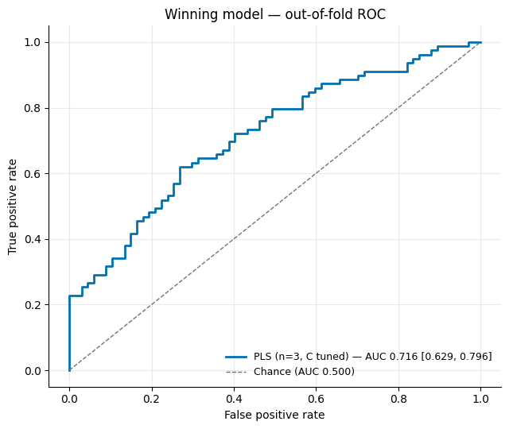
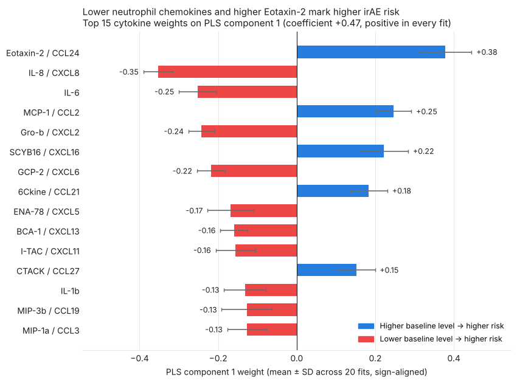

# Predicting Immune-Related Adverse Events from Baseline Cytokines

High school research project by **Vishnu Srikant** (Ridge High School, Basking Ridge, NJ),
mentored through Inspirit AI.

**Question.** Checkpoint inhibitors cause immune-related adverse events (irAEs) in many patients.
Can a patient's **baseline serum cytokine profile**, plus basic clinical metadata, predict who
will develop a **Grade 2+ irAE** before treatment starts?

**Short answer.** Partly. A PLS + regularized logistic regression model reaches an out-of-fold
ROC AUC of about **0.72 (bootstrap 95% CI 0.63-0.80)** on 146 patients; its nested
cross-validation mean is 0.730 ± 0.113 across five outer folds that ranged from 0.63 to 0.93.
The interval excludes 0.5, so the signal is above chance, but it is modest and needs external
validation.

---

## Data

- **Source:** Khan et al., *J Immunother Cancer* 2025
  ([doi:10.1136/jitc-2025-012414](https://doi.org/10.1136/jitc-2025-012414)); data on Zenodo
  ([10.5281/zenodo.17943391](https://zenodo.org/records/17943391), CC BY 4.0). Public, de-identified.
- **Modeling file:** [`ActionableData/Khan_workable.csv`](ActionableData/Khan_workable.csv):
  146 checkpoint-inhibitor patients × 40 baseline cytokines/chemokines, baseline ANA titer
  (+ missingness flag), gender, ethnicity, race, cancer type, drug.
- **Target:** `iraE_occurrence`. Grade 2+ irAE: 79 patients; Grade 0-1: 67.

## Pipeline

Run the notebooks in this order. Each one is self-contained: notebooks 01-03 ask you to upload
`Khan_workable.csv`, and the baseline and feature-analysis notebooks load it from this repository.

| Step | Notebook | What it does |
|---|---|---|
| 1. Preprocessing | [`scripts/khan_jitc_2025_download.py`](scripts/khan_jitc_2025_download.py), commit history of `Khan_workable.csv` | Download the cohort, parse below-detection tokens, encode the target, drop 16 patients without the cytokine panel (162 → 146) |
| 2. Baseline | [`notebooks/InspiritModeling_baseline.ipynb`](notebooks/InspiritModeling_baseline.ipynb) | L2 logistic regression in a leakage-free pipeline, a from-scratch reimplementation as a check, then log-scaled cytokines, elastic net and gradient boosting |
| 3. Model panel | [`notebooks/irAE_01_model_panel.ipynb`](notebooks/irAE_01_model_panel.ipynb) | 20 classifier families plus a dummy baseline under one locked preprocessing and CV protocol |
| 4. Logistic variations | [`notebooks/irAE_02_logistic_variations.ipynb`](notebooks/irAE_02_logistic_variations.ipynb) | Grid of 4 cytokine strategies (RAW / COMPOSITE / PLS / COMPOSITE+PLS) × 2 transforms × 4 regularizations |
| 5. Nested CV | [`notebooks/irAE_03_nested_cv_finalists.ipynb`](notebooks/irAE_03_nested_cv_finalists.ipynb) | Evaluation of the four finalists with the regularization strength tuned in an inner loop, plus a bootstrap CI for the winner |
| 6. Feature analysis | [`notebooks/irAE_04_feature_analysis.ipynb`](notebooks/irAE_04_feature_analysis.ipynb) | What the final model uses: PLS weights and their stability, permutation importance, univariate tests |

The notebooks for steps 3-5 (`irAE_01`, `irAE_02`, `irAE_03`) are generated by
`build_irAE_01.py`, `build_irAE_02.py` and `build_irAE_03.py` in [`scripts/modeling/`](scripts/modeling/).
An earlier PLS-stability notebook, its script and the two CSVs it wrote are kept in
[`archive/`](archive/); the feature-analysis notebook (step 6) supersedes them.

## Results

All numbers below are copied from the saved notebook outputs.

**Baseline (step 2)**, 5-fold × 10-repeat stratified CV:

| Model | ROC AUC |
|---|---|
| L2 logistic regression, raw cytokines | 0.610 ± 0.086 |
| Same, log-scaled cytokines | 0.688 ± 0.077 |
| Elastic net (nested) | 0.685 ± 0.078 |
| HistGradientBoosting | 0.622 ± 0.100 |
| Tuned HistGradientBoosting + SelectK (nested) | 0.636 ± 0.096 |

For reference, predicting the majority class gives accuracy 0.541.

**Model panel (step 3):** 20 classifiers plus a stratified dummy baseline under one
locked pipeline, 5-fold × 10-repeat stratified CV; ranked by CV AUC as saved in the notebook:

| Model | AUC (CV mean ± std) | Accuracy (CV mean) | AUC (pooled out-of-fold) |
|---|---|---|---|
| Ridge-strong LR (C=0.01) | 0.695 ± 0.082 | 0.633 | 0.678 |
| Logistic Regression (elastic net) | 0.683 ± 0.083 | 0.628 | 0.653 |
| PLS-DA (2 components) | 0.679 ± 0.079 | 0.617 | 0.678 |
| LDA (shrinkage) | 0.675 ± 0.081 | 0.623 | 0.670 |
| Logistic Regression (L2, C=1.0) | 0.675 ± 0.078 | 0.617 | 0.687 |
| Linear SVM (C=0.1) | 0.665 ± 0.080 | 0.614 | 0.661 |
| Bagged Trees | 0.659 ± 0.088 | 0.633 | 0.650 |
| Random Forest | 0.656 ± 0.087 | 0.627 | 0.640 |
| Logistic Regression (L1, C=0.1) | 0.653 ± 0.088 | 0.612 | 0.622 |
| LightGBM | 0.649 ± 0.106 | 0.617 | 0.618 |
| RBF SVM (C=1.0) | 0.647 ± 0.096 | 0.604 | 0.580 |
| XGBoost | 0.641 ± 0.095 | 0.608 | 0.645 |
| AdaBoost | 0.637 ± 0.094 | 0.597 | 0.596 |
| Extra Trees | 0.632 ± 0.083 | 0.594 | 0.638 |
| MLP (32 units) | 0.629 ± 0.089 | 0.594 | 0.643 |
| Gradient Boosting | 0.629 ± 0.096 | 0.594 | 0.621 |
| HistGradientBoosting | 0.622 ± 0.093 | 0.601 | 0.601 |
| k-NN (k=15) | 0.604 ± 0.089 | 0.594 | 0.578 |
| Decision Tree (depth 4) | 0.579 ± 0.091 | 0.589 | 0.608 |
| Gaussian Naive Bayes | 0.575 ± 0.098 | 0.549 | 0.581 |
| Dummy (stratified) | 0.489 ± 0.091 | 0.499 | 0.497 |

Regularized linear and latent-variable models lead the panel; tree ensembles and boosting are lower.

**Logistic variations (step 4):** best configurations by CV AUC:

| Strategy | Transform | Regularization | AUC |
|---|---|---|---|
| COMPOSITE+PLS | log1p | L2, C=0.1 | 0.720 ± 0.093 |
| PLS | log1p | L2, C=0.1 | 0.719 ± 0.093 |
| RAW | log1p | L2, C=0.1 | 0.705 ± 0.083 |
| COMPOSITE | log1p | L2, C=0.1 | 0.687 ± 0.081 |

L1 on composite scores collapsed (AUC 0.475 ± 0.054).

**Nested CV (step 5):** C tuned in the inner loop; 5 outer folds:

| Strategy | Nested AUC |
|---|---|
| PLS (3 components) | 0.730 ± 0.113 |
| COMPOSITE+PLS | 0.729 ± 0.118 |
| RAW | 0.711 ± 0.110 |
| COMPOSITE | 0.710 ± 0.102 |

Winner (PLS, n=3): pooled out-of-fold AUC 0.716, bootstrap 95% CI [0.629, 0.796].

The repo contains four estimates for this same model; the most conservative ones are the best
summary:

| Estimate | Value |
|---|---|
| Nested CV, 5 outer folds | 0.730 ± 0.113 |
| Nested CV with the PLS component count also tuned | 0.722 ± 0.132 |
| Pooled out-of-fold, bootstrap 95% CI | 0.716 [0.629, 0.796] |
| 20 repeated fits (step 6) | 0.713 ± 0.095 |



**Feature analysis (step 6)**, across 20 fits (held-out AUC 0.713 ± 0.095):
- PLS component 1 carries the signal: coefficient +0.470 ± 0.074, positive in 20/20 fits,
  with 20 of 40 cytokine weights sign-stable.
- Largest component-1 weights: Eotaxin-2/CCL24 +0.378 (higher level → higher risk),
  IL-8/CXCL8 −0.353 and IL-6 −0.253 (lower level → higher risk), MCP-1/CCL2 +0.246.
- Permutation importance (mean drop in held-out AUC): IL-8/CXCL8 0.0474, Eotaxin-2/CCL24 0.0263,
  cancer group 0.0221, GCP-2/CXCL6 0.0195, IL-2 0.0166, baseline ANA titer 0.0159, IL-6 0.0149.
- Univariate tests: only IL-8/CXCL8 passes the Bonferroni threshold (p < 0.00125). Its median is
  7.03 in irAE patients vs 10.35 without irAE (p = 0.0002).



## Limitations

- **Small cohort:** 146 patients, so every estimate is wide. Fold-to-fold AUC standard
  deviations range from 0.077 to 0.132, larger than the gaps between the top models.
- **Model selection on the same data:** nested CV tunes only the regularization strength. The
  feature strategy, the log transform and the number of PLS components were chosen from screens
  on the same 146 patients, and the winner is the best of four strategies on the same folds, so
  the estimates above are likely somewhat optimistic.
- **No external validation:** all results are internal cross-validation on a single public
  dataset; cohort quirks (site, assay batch, case mix) can't be separated from real signal.
- **Retrospective and observational:** associations are not causal, and baseline cytokines
  are one snapshot.
- **Missing data:** ANA titer is missing for 91 of 146 patients (62%; median-imputed, with a
  missingness flag).
- **Detection limits:** several cytokines sit at the assay's detection floor for many patients
  (ENA-78/CXCL5 for 33.6%), so their values partly record whether they were detectable at all.
- **Re-analysis, not replication:** Khan et al. (2025) analysed this same dataset, so agreement
  with their conclusions is not independent confirmation.
- **Not a clinical tool:** this is a student research prototype.

## Repository layout

```
ActionableData/    modeling-ready data (Khan_workable.csv) and dataset figures
notebooks/         analysis notebooks, steps 2-6
scripts/           data download scripts; scripts/modeling/ builds the step 3-5 notebooks
archive/           superseded PLS-stability notebook, script and CSVs
datasets/          other public datasets assembled for future work (FAERS, cBioPortal, Chowell 2021)
docs/              project background, original research plan, README figures
.claude/           instructions for the AI coding assistant (original project plan)
requirements.txt   Python packages used
LICENSE            MIT license for the code
```

## How this was built

Vishnu developed this project with a research mentor through Inspirit AI and used AI coding
assistants (Claude Code) to help write code and documentation; the `.claude/` folder holds
those assistant instructions. The modeling choices, results and limitations are documented
in the notebooks so each step can be checked and re-run.

The original project plan (an irAE severity model using FDA FAERS reports) is in
[`docs/project_background.md`](docs/project_background.md).

## License

Code: [MIT](LICENSE). Data: the Khan et al. cohort is CC BY 4.0 (see below); other datasets in
`datasets/` keep their original terms.

## Data citation

Khan et al. *J Immunother Cancer* 2025. doi:10.1136/jitc-2025-012414. Data:
doi:10.5281/zenodo.17943391 (CC BY 4.0).
